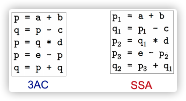

#PL 

## 参考
- https://mp.weixin.qq.com/s/vc8ZDkrSxUV237C020E5Ag
- https://mp.weixin.qq.com/s/r3kr7osh34OTL-Z8gtK2rg
## 学习路线
- 现存的唯一的系统学习课程：南京大学的《静态软件分析》课程；上B站搜一下就能搜到公开课；
- GadgetInspector：使用Java ASM模拟JVM堆栈，实现调用图分析、污点传播分析；
- Datalog引擎souffle：[https://souffle-lang.github.io/tutorial](https://souffle-lang.github.io/tutorial)；
- neo4j图数据库：[https://www.cnblogs.com/ljhdo/p/5516793.html](https://www.cnblogs.com/ljhdo/p/5516793.html) ；
- ByteCodeDL：使用soot生成fact，使用souffle作为datalog引擎，最后使用neo4j进行可视化，实现了多种程序分析算法；
- ByteCodeDL：  discussions：[https://github.com/BytecodeDL/ByteCodeDL/discussions](https://github.com/BytecodeDL/ByteCodeDL/discussions) ；
- Doop介绍：[https://y4er.com/posts/doop-1/](https://y4er.com/posts/doop-1/) ；
- Doop官方仓库：[https://bitbucket.org/yanniss/doop/src/master/](https://bitbucket.org/yanniss/doop/src/master/) ；
- Doop dl规则：[https://github.com/plast-lab/doop-mirror/blob/master/souffle-logic/facts/imports.dl](https://github.com/plast-lab/doop-mirror/blob/master/souffle-logic/facts/imports.dl) ；
- Doop Issus：[https://bitbucket.org/yanniss/doop/issues/27](https://bitbucket.org/yanniss/doop/issues/27) ；
- Soot Doc：[https://soot-build.cs.uni-paderborn.de/public/origin/develop/soot/soot-develop/options/soot_options.htm#phase_5](https://soot-build.cs.uni-paderborn.de/public/origin/develop/soot/soot-develop/options/soot_options.htm#phase_5) ；
- Tabby：基于soot生成代码属性图，应用案例比较多：[https://github.com/wh1t3p1g/tabby](https://github.com/wh1t3p1g/tabby)；
- 静态程序分析相关论文：[https://yanniss.github.io/](https://yanniss.github.io/) ；
- pascal实验室公开论文（李樾、谭添老师所在的实验室）：[https://pascal-group.bitbucket.io/code.html](https://pascal-group.bitbucket.io/code.html) 。


## 基础概念

### IR（Intermediate Representation）

IR即“中间表示”，通常IR的表现形式为三地址码（3AC，3 Adress Code），静态程序分析通常会将IR转换为CFG（Controll Flow Graph）进行下一步分析；
  

三地址码（3AC）的特征：一条指令的右侧最多有一个运算符，每一个3AC最多包含3个address，每种类型的指令都有对应的3AC；
  

```C
// Original C Code
int a = 10;
int b = 20;
int c;
if (a < b) {
    c = a + b;
} else {
    c = a - b;
}
printf("%d", c); // Assume we just care about the value of c
```

1. 转换为3AC
```
(1) a = 10
(2) b = 20
(3) t3 = a < b      // 比较 a < b, 结果存t3
(4) if t3 goto (7)  // 如果t3为真(非零)，跳转到第7行 (then部分)
(5) t4 = a - b      // else部分开始
(6) c = t4
(7) goto (10)       // 跳过then部分，直接到结束 (L3)
(8) t5 = a + b      // then部分开始 (标签L1)
(9) c = t5
(10)               // 标签L3 (结束)
(11) ...           // printf(c) 或其他使用c的代码
```


### SSA ( Static Single Assignment)

SSA即为“静态单一分配”，SSA中的所有赋值都有不同名称的变量，详细解释如下：
- 每个定义需要给定一个新的名字；
- 将新名称传播给后续使用；
- 每个变量都只有一个定义。

例如如下即为3AC和SSA的对比：


  


一般生成SSA要比3AC慢很多，但是有时可以利用SSA来提高非敏感数据流分析的精度。

### CFG( Control Flow Graph)

> 通常所有的控制流分析（Control Flow Analysis）指的就是创建控制流图（Control Flow Graph）；

 1. CFG 是 IR 的图形化表示，用于展示程序执行时可能的路径。节点代表**基本块 (Basic Block)**，边代表**控制流转移**（顺序执行、条件分支、无条件跳转）
2. **基本块 (BB):** ​ 一段**顺序执行**的语句序列，只有一个入口（第一条指令）和一个出口（最后一条指令）。块内没有跳转进入或跳出（除了入口和出口）。
3. **CFG 构建:**
	1. 将3AC指令序列划分为基本块。
	2. 根据跳转指令 (`goto`, `if...goto`) 和标签确定块之间的边。


  


上面的CFG中，存在两个特殊的节点：Entry和Exit，这两个节点的性质如下：

- 它们不对应于可执行的 IR；
- `Entry`存在一条`Edge`指向一个`BB`，这个`BB`包含整个IR的第一条指令，也就是这个BB是整个程序的`第一个BB`；
- 某个`BB`存在一条`Edge`指向`Exit`，这个`BB`包含整个IR的最后一条指令，也就是这个BB是整个程序的`最后一个BB`。
